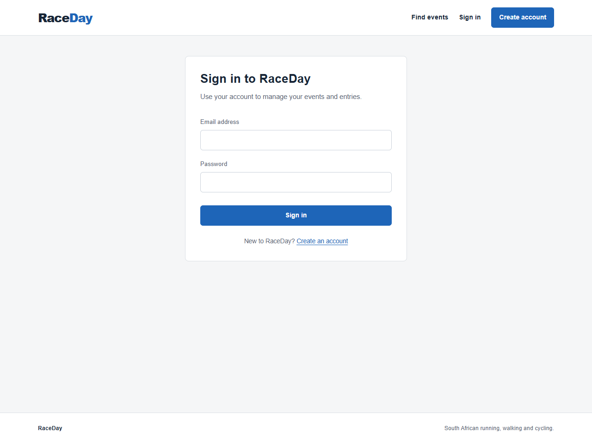
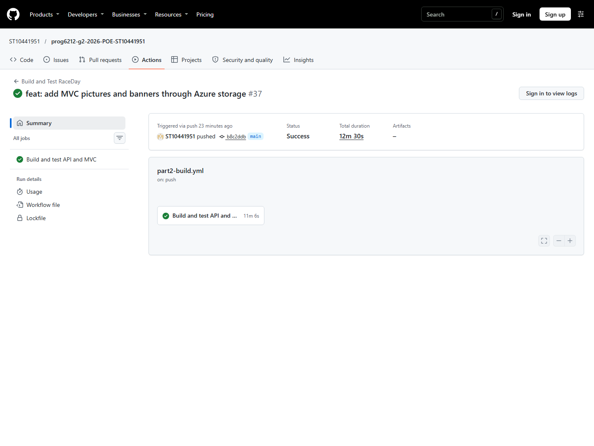

# RaceDay - Part 3

## Project overview

RaceDay manages South African running, walking and cycling events. Part 3 adds an ASP.NET Core MVC website to the Part 2 API, with separate pages for Organisers and Participants, Azure image uploads and Docker (The Independent Institute of Education, 2026; Microsoft, 2026a).

The MVC event search, details, accounts, protected pages, entries, personal results and profiles are working through the API. Organiser management, result capture, image uploads and Docker remain to be added. Progress is recorded in the [Part 3 checklist](docs/Part-3-Requirements-Checklist.md).

Previous work: [Part 1 README](README-Part1.md) and [Part 2 README](README-Part2.md).

## User roles

| Role | Responsibilities |
|---|---|
| Organiser | View the dashboard; manage owned events, banners and categories; view enrolments and record results. |
| Participant | Browse and enter events; view own entries and results; update personal details and upload a profile picture. |

Both roles register and log in through the API. MVC keeps user ID, role and the API cookie on the server; the browser receives a separate protected session identifier. Each request rechecks the account through the API. The header shows the correct role's home link, guests are redirected to sign-in and the wrong role receives 403. Sign-out clears the session. See the [account notes](docs/Part-3-Accounts.md) (Microsoft, 2026b; 2026g; 2026h).

## Application

The MVC website uses a typed HTTP client to call the API. Database access and business rules remain in the API. Files will pass from MVC to the API; only the API communicates with Azure Blob Storage (The Independent Institute of Education, 2026; Microsoft, 2026e).

The existing API has 40 business endpoints and seven SQL Server tables. See the [endpoint plan](docs/API-Endpoint-Plan.md) and [database notes](docs/Part-2-Database.md).

The shared MVC layout uses the Event finder design: blue accents, a light background, compact navigation and white event cards. Bootstrap styles are served locally (Bootstrap, 2026).

| Area | Current status |
|---|---|
| Part 1 planning and database | Complete |
| Part 2 API, sessions and tests | Complete |
| API picture and banner endpoints | Implemented; Part 3 Azure demonstration pending |
| MVC project, API connection and shared layout | Implemented; [MVC notes](docs/Part-3-MVC.md) |
| Public event search, paging, categories and routes | Implemented; [event notes](docs/Part-3-Events.md) |
| Participant entries, changes and My entries | Implemented; [entry notes](docs/Part-3-Entries.md) |
| Registration, login and sign-out | Working for both roles; [account notes](docs/Part-3-Accounts.md) |
| Role-specific navigation and protected home pages | Implemented; API session rechecked before access |
| Personal profiles and password changes | Working for both roles; [profile notes](docs/Part-3-Profiles.md) |
| Participant race history and result details | Implemented; [result notes](docs/Part-3-Results.md) |
| Organiser management, result capture and MVC image uploads | Pending |
| Docker | Not started |

## MVC screenshots

The home page displays live API events and supports province, event type and date filters. Pagination keeps the selected filters. The search screenshots use temporary review fixtures to show multiple pages.


The [mobile layout](docs/evidence/part3-event-finder-mobile.png) stacks the filters and event details on smaller screens.

Event names open full details with categories and routes. See [event details](docs/evidence/part3-event-details-desktop.png), the [mobile detail page](docs/evidence/part3-event-details-mobile.png) and [filtered pagination](docs/evidence/part3-event-pagination.png).

Both roles use the same sign-in form. The [registration page](docs/evidence/part3-registration.png) includes account type and optional personal details.



Protected pages: [Organiser home](docs/evidence/part3-organiser-home.png), [Participant home](docs/evidence/part3-participant-home.png) and [access denied](docs/evidence/part3-access-denied.png). These pages retain the same Event finder style.

Participant entry: [select category](docs/evidence/part3-enter-event.png), [saved entry](docs/evidence/part3-entry-confirmation.png) and [My entries](docs/evidence/part3-my-entries.png). The screenshots use fictional review accounts.

Entry changes: [cancel confirmation](docs/evidence/part3-entry-cancel-confirmation.png), [reactivation](docs/evidence/part3-entry-reactivate.png) and [delete confirmation](docs/evidence/part3-entry-delete-confirmation.png).

Profiles: [personal details](docs/evidence/part3-profile.png), [edit form](docs/evidence/part3-profile-edit.png) and [password change](docs/evidence/part3-password-change.png). Both roles have a My profile link.

Personal results: [race history](docs/evidence/part3-my-results.png), [result details](docs/evidence/part3-result-details.png) and [non-finishing result](docs/evidence/part3-result-did-not-finish.png). These screenshots use temporary review fixtures.

## Setup and run

Install the .NET 10 SDK, SQL Server LocalDB and Node.js with npm. Visual Studio needs .NET 10 support and the ASP.NET/web workload.

1. Clone the repository.

```text
git clone https://github.com/ST10441951/prog6212-g2-2026-POE-ST10441951.git
cd prog6212-g2-2026-POE-ST10441951
```

2. Restore and build the solution.

```text
dotnet restore RaceDay.sln
dotnet tool restore
dotnet build RaceDay.sln --configuration Release --no-restore
```

3. Follow [Part 2 setup steps 3-5](README-Part2.md#setup-and-run) to set the SQL connection, apply migrations and start Azurite. Keep storage running for image tests.

4. Start the API in one PowerShell terminal.

```text
$env:ASPNETCORE_ENVIRONMENT = 'Development'
dotnet run --project src/RaceDay.Api --configuration Release --no-build --launch-profile http
```

5. Start MVC in another terminal. `Api__BaseUrl` selects the API address (Microsoft, 2026e).

```text
$env:ASPNETCORE_ENVIRONMENT = 'Development'
$env:Api__BaseUrl = 'http://localhost:5120/'
dotnet run --project src/RaceDay.Web --configuration Release --no-build --launch-profile http
```

6. Open [RaceDay](http://localhost:5180/) or [API Swagger](http://localhost:5120/swagger/index.html). In Visual Studio, open `RaceDay.sln` and configure both API and Web as startup projects using their `http` profiles.

The home page displays three upcoming events per page. Filter by province, event type or inclusive UTC dates, then open an event for its details, categories and routes. Times are displayed in SAST. Search starts on page 1, page links retain filters and Clear filters resets the search.

Use Create account or Sign in in the header. Registration redirects to sign-in; login opens `/organiser` or `/participant`. A valid local return address takes the user back to the requested page. External destinations are rejected (Microsoft, 2026i). The fictional [Part 2 sample accounts](README-Part2.md#setup-and-run) also work through MVC.

Participants can open an Open event, choose Enter event, select a category and confirm. My entries lists their saved records and statuses. Age-restricted categories require a date of birth on the account; include it when registering or add it under My profile.

Open a saved entry to cancel, reactivate or delete it. Cancel keeps the history; Delete requires explicit confirmation and removes a permitted Confirmed entry. Reactivation can keep or change category. The API rejects closed entries, full categories, recorded results and other users' records.

Both roles can use My profile to view their account, edit names, phone number and birth date, or change their password. Blank optional fields are cleared. A successful password change signs out the current browser; sign in again with the new password. Email and role cannot be changed here. See the [profile notes](docs/Part-3-Profiles.md).

Participants can open My results to see official race history, filter by outcome and open a saved result. Times appear as hours:minutes:seconds, with positions and event-wide finisher totals from the API. Did not finish, Did not start and Disqualified results have no official time or rank. The Organiser must record a result before it appears here.

A stopped API produces a friendly message instead of an empty list or raw error. See [MVC settings](docs/Part-3-MVC.md#2-settings).

7. Run tests with the API test database server and Azurite available. The MVC tests do not need the API running (Microsoft, 2026f).

```text
dotnet test RaceDay.sln --configuration Release --no-build
```

## Azure Blob Storage

The API already supports Participant pictures and Organiser banners. It validates JPEG/PNG files and stores generated blob names in SQL. Reads return temporary image URLs. See the [image notes](docs/Part-2-Images.md) (Microsoft, 2026c).

Part 3 will add upload controls and image display in MVC. The final checks must demonstrate images stored in Azure through the API. Azurite remains available for local development and tests.

## Docker

The MVC Dockerfile, container checks and tested build/run commands are still to be added (Microsoft, 2026d).

## CI/CD

The [build workflow](.github/workflows/part2-build.yml) now builds the API, MVC and both test projects. The [planning workflow](.github/workflows/part1-validation.yml) checks the planning files and required Part 3 files (GitHub, 2026).

Both workflows passed for `573ce6d` using temporary Windows runners on my PC: [build and tests](https://github.com/ST10441951/prog6212-g2-2026-POE-ST10441951/actions/runs/44367577876) and [planning validation](https://github.com/ST10441951/prog6212-g2-2026-POE-ST10441951/actions/runs/44367577847). The build ran 810 API tests and 257 MVC tests, with none failed or skipped. The migration check also passed.



The [planning screenshot](docs/evidence/part3-ci-planning-success.png) records the second green check. Earlier hosted jobs were blocked by an account billing issue. `RACEDAY_USE_LOCAL_RUNNER` selects the temporary local runner; each job needs a new registration and the PC online. No tests were skipped to obtain these results. See the [CI notes](docs/Part-3-CI.md).

The newer My results pages have 293 passing MVC tests locally and are not yet included in the recorded GitHub revision.

## Unit tests

Part 2 includes 810 tests recorded in the [Part 2 README](README-Part2.md#unit-tests). MVC now has 293 checks covering browsing, entries, personal results, profiles, password changes, settings, accounts, validation, cookies, role restrictions and redirects (Microsoft, 2026f).

All 293 MVC checks passed locally on 18 November 2026, with none failed or skipped. The unchanged 810 API tests also passed in GitHub on that date. The Release build has zero warnings or errors, and planning checks pass. Browser checks verified accounts, browsing, entries, results, profiles and password changes against isolated databases. See the [account](docs/Part-3-Accounts.md#5-checks-and-evidence), [event](docs/Part-3-Events.md#3-checks-and-evidence), [entry](docs/Part-3-Entries.md#4-checks-and-evidence), [profile](docs/Part-3-Profiles.md#4-checks-and-evidence) and [result checks](docs/Part-3-Results.md#4-checks-and-evidence).

## Project files

| File/folder | Contents |
|---|---|
| [Part 1 README](README-Part1.md) | Original planning and database submission |
| [Part 2 README](README-Part2.md) | API setup, features, tests and evidence |
| [Part 3 checklist](docs/Part-3-Requirements-Checklist.md) | Requirements and outstanding work |
| [MVC notes](docs/Part-3-MVC.md) | API connection, settings, layout and checks |
| [Account notes](docs/Part-3-Accounts.md) | Registration, login, protected pages, sessions and sign-out |
| [Event notes](docs/Part-3-Events.md) | Search, paging, public details, categories, routes and checks |
| [Entry notes](docs/Part-3-Entries.md) | Category selection, saved entries, private history and checks |
| [Profile notes](docs/Part-3-Profiles.md) | Personal details, password changes and checks |
| [Result notes](docs/Part-3-Results.md) | Private race history, finish times, positions and checks |
| [CI notes](docs/Part-3-CI.md) | Hosted billing failure, local runner and workflow checks |
| `src/RaceDay.Web/` | MVC controllers, views, API client and local Bootstrap styles |
| `src/RaceDay.Api/` | Existing API, database mappings, sessions and storage |
| `tests/RaceDay.Web.Tests/` | MVC and HTTP connection checks |
| `tests/RaceDay.Api.Tests/` | Existing API and database tests |
| `tools/RaceDay.PlanningChecks/` | Planning-document checks |
| `.github/workflows/` | API/MVC build and planning-validation workflows |
| `docs/evidence/` | Part 1/2 evidence and Part 3 desktop/mobile screenshots |

## Video

The Part 3 walkthrough has not been recorded. Its unlisted YouTube link will be added here after recording.

## References

GitHub (2026) 'Building and testing .NET', *GitHub Docs*. Available at: https://docs.github.com/en/actions/tutorials/build-and-test-code/net (Accessed: 18 November 2026).

Microsoft (2026a) 'Overview of ASP.NET Core MVC', *Microsoft Learn*. Available at: https://learn.microsoft.com/en-us/aspnet/core/mvc/overview?view=aspnetcore-10.0 (Accessed: 18 November 2026).

Microsoft (2026b) 'Session and state management in ASP.NET Core', *Microsoft Learn*. Available at: https://learn.microsoft.com/en-us/aspnet/core/fundamentals/app-state?view=aspnetcore-10.0 (Accessed: 18 November 2026).

Microsoft (2026c) 'Upload a blob with .NET', *Microsoft Learn*. Available at: https://learn.microsoft.com/en-us/azure/storage/blobs/storage-blob-upload (Accessed: 18 November 2026).

Microsoft (2026d) 'Run an ASP.NET Core app in Docker containers', *Microsoft Learn*. Available at: https://learn.microsoft.com/en-us/aspnet/core/host-and-deploy/docker/building-net-docker-images?view=aspnetcore-10.0 (Accessed: 18 November 2026).

Microsoft (2026e) 'Make HTTP requests using IHttpClientFactory in ASP.NET Core', *Microsoft Learn*. Available at: https://learn.microsoft.com/en-us/aspnet/core/fundamentals/http-requests?view=aspnetcore-10.0 (Accessed: 18 November 2026).

Microsoft (2026f) 'Integration tests in ASP.NET Core', *Microsoft Learn*. Available at: https://learn.microsoft.com/en-us/aspnet/core/test/integration-tests?view=aspnetcore-10.0 (Accessed: 18 November 2026).

Microsoft (2026g) 'Overview of ASP.NET Core authentication', *Microsoft Learn*. Available at: https://learn.microsoft.com/en-us/aspnet/core/security/authentication/?view=aspnetcore-10.0 (Accessed: 18 November 2026).

Microsoft (2026h) 'Role-based authorization in ASP.NET Core', *Microsoft Learn*. Available at: https://learn.microsoft.com/en-us/aspnet/core/security/authorization/roles?view=aspnetcore-10.0 (Accessed: 18 November 2026).

Microsoft (2026i) 'Prevent open redirect attacks in ASP.NET Core', *Microsoft Learn*. Available at: https://learn.microsoft.com/en-us/aspnet/core/security/preventing-open-redirects?view=aspnetcore-10.0 (Accessed: 18 November 2026).

Bootstrap (2026) 'Download', *Bootstrap v5.3*. Available at: https://getbootstrap.com/docs/5.3/getting-started/download/ (Accessed: 18 November 2026).

The Independent Institute of Education (2026) *PROG6212 Portfolio of Evidence*. Part 3 requirements and marking rubric. Assessment brief.
