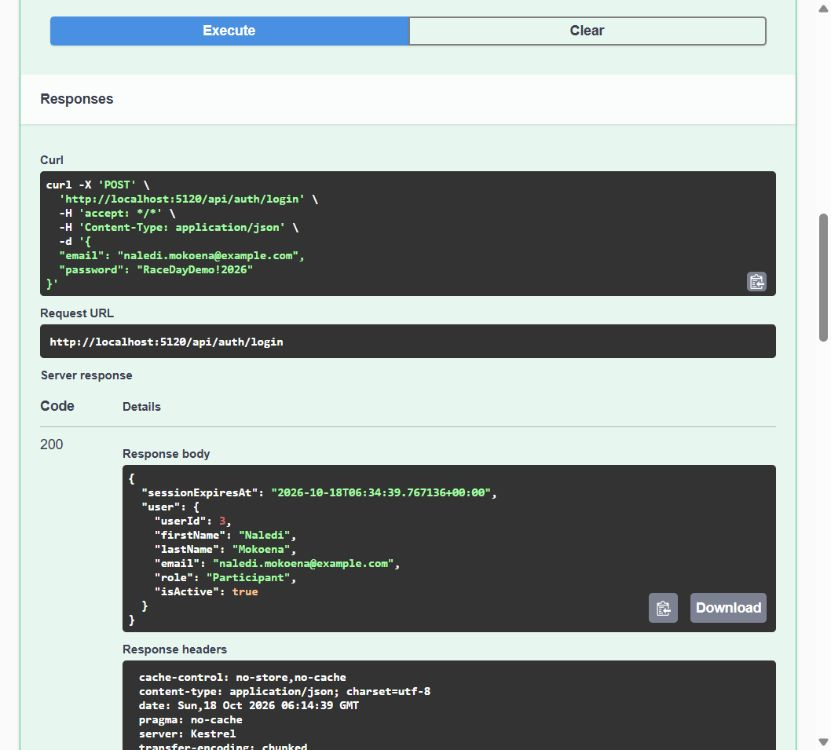
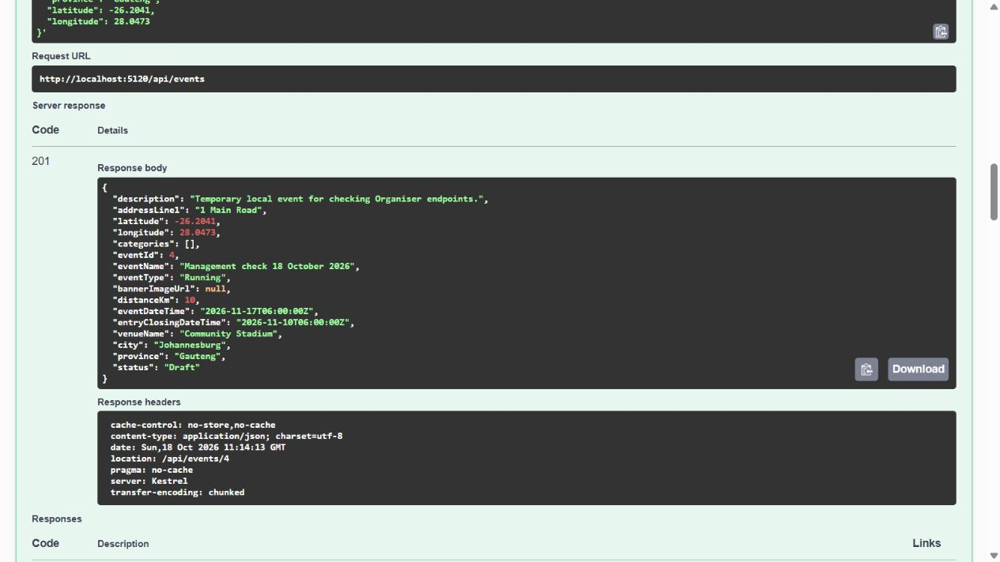
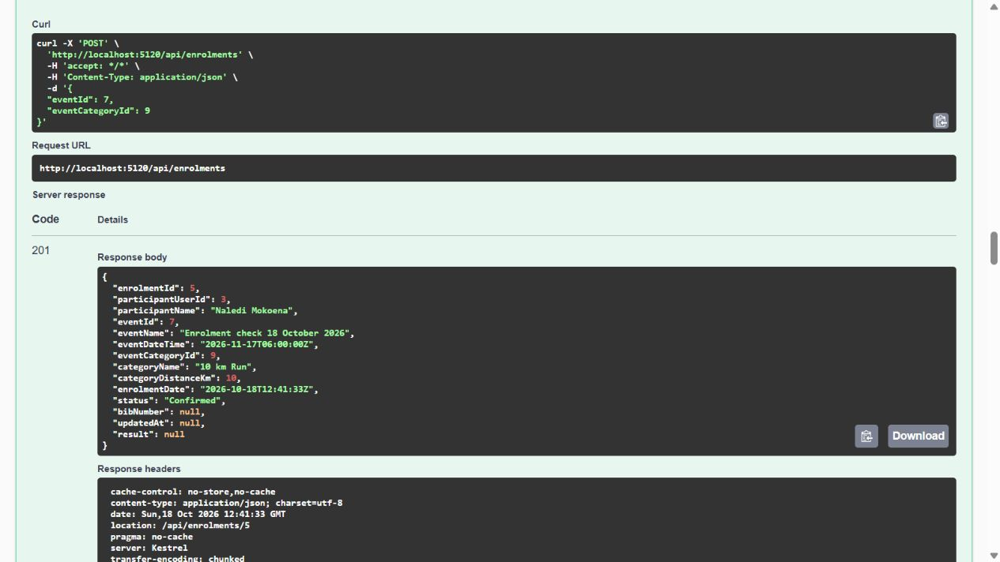
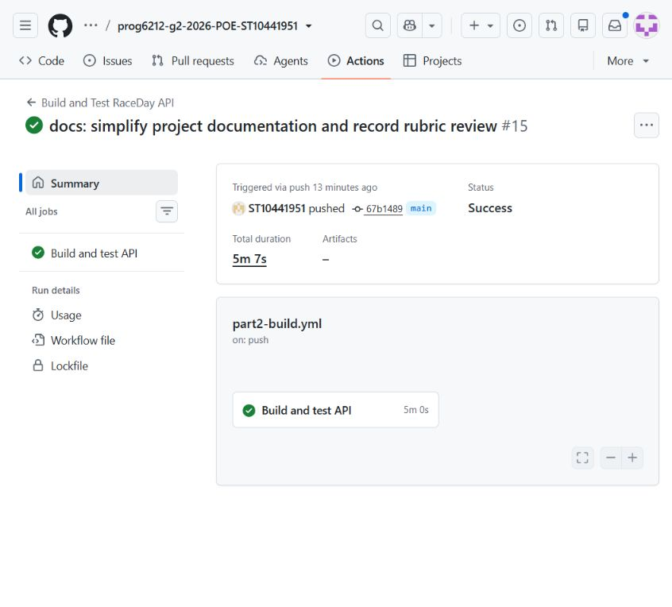
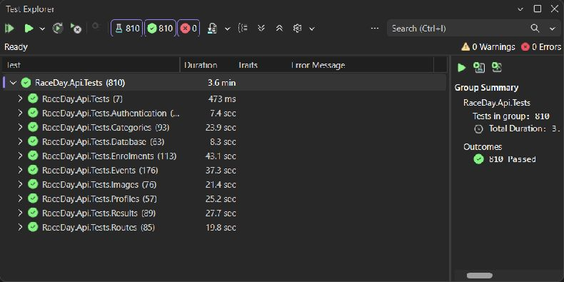

# RaceDay - Part 2

[](https://github.com/ST10441951/prog6212-g2-2026-POE-ST10441951/actions/workflows/part2-build.yml)

## Project overview

RaceDay manages South African running, walking and cycling events. Part 2 is a C# ASP.NET Core API using SQL Server and EF Core (The Independent Institute of Education, 2026a).

All 40 planned business endpoints are implemented. The original [Part 1 README](README-Part1.md) is preserved. Progress is in the [checklist](docs/Part-2-Requirements-Checklist.md) and [rubric review](docs/Part-2-Rubric-Review.md).

## User roles

| Role | Responsibilities |
|---|---|
| Organiser | Manage owned events, categories, routes and banners; view rosters, assign bibs and record results. |
| Participant | Update own profile and picture, browse events, enter a category and view own entries/results. |

Both roles manage their own profile. Login keeps user ID and role in a server-side session for 20 minutes. Passwords are hashed; role and ownership checks protect private records (Microsoft, 2026a; 2026k; 2026o).

## Database

The seven tables are Roles, Users, Events, EventCategories, EventRoutes, Enrolments and Results. EF migrations create `RaceDayPart2`, separate from Part 1 `RaceDay` (Microsoft, 2026b).

All 71 columns and nine relationships match Part 1. One detail differs: `UQ_EventCategories_Event_CategoryName` is a unique index rather than a UNIQUE constraint, allowing EF to rename categories while preserving uniqueness. The composite category/event key remains (Microsoft, 2026f; 2026g).

See the [database notes](docs/Part-2-Database.md). SQL stores generated image blob names; files stay in private Blob Storage. MVC and Docker belong to Part 3.

## API endpoints

The [endpoint plan](docs/API-Endpoint-Plan.md) lists all 40 methods, routes, roles, bodies and responses, including the [25 required operations](docs/API-Endpoint-Plan.md#141-required-operations).

Swagger also includes `GET /health`, a separate host check returning `200` and `{"status":"Healthy"}`. It does not check SQL or storage (Microsoft, 2026c; Swashbuckle, 2026).

## API screenshots

Participant login returns `200` and starts a session.



An Organiser creates a Draft event and receives `201 Created`.



A Participant enters an event category and receives a Confirmed enrolment.



## Setup and run

Install the .NET 10 SDK, SQL Server LocalDB and Node.js with npm. Visual Studio needs .NET 10 support and the ASP.NET/web workload. Another SQL Server can be used by changing the connection string.

1. Clone the repository (GitHub, 2026a).

```text
git clone https://github.com/ST10441951/prog6212-g2-2026-POE-ST10441951.git
cd prog6212-g2-2026-POE-ST10441951
```

2. Restore and build.

```text
dotnet restore RaceDay.sln
dotnet tool restore
dotnet build RaceDay.sln --configuration Release --no-restore
```

3. Set Development and the connection string in PowerShell (Microsoft, 2026h).

```text
$env:ASPNETCORE_ENVIRONMENT = 'Development'
$env:ConnectionStrings__RaceDay = 'Server=(localdb)\MSSQLLocalDB;Database=RaceDayPart2;Integrated Security=True;Encrypt=True;TrustServerCertificate=True'
```

This local connection is also in `appsettings.Development.json`. Keep private settings in environment variables or user secrets. TrustServerCertificate is for local development.

4. Create the database and apply migrations (Microsoft, 2026i).

```text
dotnet ef database update --project src/RaceDay.Api --configuration Release --no-build
```

This creates tables and sample data. Rerunning preserves data. Do not apply the Part 1 SQL script to `RaceDayPart2`.

5. Start Azurite in another terminal and keep it running for images/tests (Microsoft, 2026w).

```text
npx --yes --package azurite@3.37.0 azurite-blob --blobHost 127.0.0.1 --location .azurite --silent
```

Development uses `UseDevelopmentStorage=true` and the private `raceday-images` container. Azure settings use `ImageStorage__ConnectionString` and optional `ImageStorage__ContainerName`; keep real keys out of Git. See [image setup](docs/Part-2-Images.md).

6. Start the API.

```text
dotnet run --project src/RaceDay.Api --configuration Release --no-build --launch-profile http
```

7. Open [Swagger](http://localhost:5120/swagger/index.html). Select Try it out, then Execute. Start with `/health`, then log in. The browser sends the session cookie automatically; Authorize is not needed.

| Role | Sample email | Password |
|---|---|---|
| Organiser | thabo.ndlovu@example.com | RaceDayDemo!2026 |
| Organiser | ayesha.khan@example.com | RaceDayDemo!2026 |
| Participant | naledi.mokoena@example.com | RaceDayDemo!2026 |
| Participant | sipho.dlamini@example.com | RaceDayDemo!2026 |

These are fictional local accounts. Use a new account for password-change checks. Event 1 has past sample results; events 2 and 3 are upcoming while their dates remain in the future. New events start Draft and need an available category before opening.

8. Run tests from another terminal (Microsoft, 2026e).

```text
dotnet test RaceDay.sln --configuration Release --no-build
```

In Visual Studio, open `RaceDay.sln`, set `RaceDay.Api` as startup project and choose `http`. Open Test > Test Explorer > Run All.

Tests use separate `RaceDayTests_...` databases and `raceday-tests-...` containers. `RACEDAY_TEST_CONNECTION` and `RACEDAY_TEST_STORAGE_CONNECTION` can select another server/account. The fixtures always choose their own test database/container names (Microsoft, 2026d; 2026j).

Outside Development, configure SQL/storage separately. Swagger is disabled and HTTPS is enforced.

## CI/CD

GitHub Actions builds and tests the solution on every push, checks migrations and validates the planning files (GitHub, 2026b; 2026c; 2026d; 2026e).

Revision `d18e1da`: [API workflow](https://github.com/ST10441951/prog6212-g2-2026-POE-ST10441951/actions/runs/39222622486) passed all 810 tests with none skipped, zero warnings/errors and no pending model changes. The [planning workflow](https://github.com/ST10441951/prog6212-g2-2026-POE-ST10441951/actions/runs/39222622517) also passed.



## Unit tests

| Area | Checks |
|---|---:|
| Startup | 7 |
| Database | 63 |
| Authentication | 51 |
| Profiles/passwords | 57 |
| Event browsing | 55 |
| Event management | 121 |
| Categories | 93 |
| Routes | 85 |
| Enrolments | 113 |
| Results | 89 |
| Images | 76 |
| Total | 810 |

Tests cover success/failure, sessions, roles, ownership, validation, saved data and concurrent requests. Collections run sequentially; explicit concurrent-request tests still run together (xUnit.net, 2026a; 2026b).

Visual Studio Run All passed all 810 tests on 19 October, with zero failed or skipped. The local Windows execution block is resolved. Planning checks passed, the database is up to date and EF reports no pending model changes. See the [rubric review](docs/Part-2-Rubric-Review.md).



The [GitHub test output](docs/evidence/part2-github-tests.jpg) also shows all 810 tests passing.

## Project files

| File/folder | Contents |
|---|---|
| `src/RaceDay.Api/` | API, models, EF mappings, authentication and storage |
| `tests/RaceDay.Api.Tests/` | xUnit tests |
| `tools/RaceDay.PlanningChecks/` | C# planning checks |
| `.github/workflows/` | Build and validation workflows |
| [Endpoint plan](docs/API-Endpoint-Plan.md) | All methods, routes, bodies and responses |
| [Data dictionary](docs/RaceDay-Data-Dictionary.md) | Columns, keys and constraints |
| [SQL script](docs/RaceDay.sql) | Part 1 schema and seeds |
| [Part 1 corrections](docs/Part-1-Database-Corrections.md) | Corrected SQL and SSMS evidence |
| [Authentication](docs/Part-2-Authentication.md) / [Profiles](docs/Part-2-Profiles.md) | Accounts, sessions and personal details |
| [Browsing](docs/Part-2-Event-Browsing.md) / [Event management](docs/Part-2-Event-Management.md) | Events and dashboard |
| [Categories](docs/Part-2-Categories.md) / [Routes](docs/Part-2-Routes.md) | Category and route rules |
| [Enrolments](docs/Part-2-Enrolments.md) / [Results](docs/Part-2-Results.md) | Entries, bibs and official results |
| [Images](docs/Part-2-Images.md) | Uploads and storage |
| `docs/evidence/` | Screenshots, including the [host check](docs/evidence/swagger-host-check.jpg) |

## Video

Watch the [Part 2 video](https://youtu.be/M8tMMSOEfVc) (Unlisted, 9 minutes 14 seconds).

The walkthrough covers the rubric, Swagger endpoints, core code, roles, database, Run All and GitHub Actions, with my own narration (The Independent Institute of Education, 2026b).

## References

GitHub (2026a) 'Getting changes from a remote repository', *GitHub Docs*. Available at: https://docs.github.com/en/get-started/using-git/getting-changes-from-a-remote-repository (Accessed: 19 September 2026).

GitHub (2026b) 'Workflow syntax for GitHub Actions', *GitHub Docs*. Available at: https://docs.github.com/en/actions/reference/workflows-and-actions/workflow-syntax (Accessed: 17 October 2026).

GitHub (2026c) 'actions/setup-dotnet', *GitHub*. Available at: https://github.com/actions/setup-dotnet (Accessed: 17 October 2026).

GitHub (2026d) 'Building and testing .NET', *GitHub Docs*. Available at: https://docs.github.com/en/actions/tutorials/build-and-test-code/net (Accessed: 17 October 2026).

GitHub (2026e) 'Windows Server 2025', *actions/runner-images*. Available at: https://github.com/actions/runner-images/blob/main/images/windows/Windows2025-Readme.md (Accessed: 18 October 2026).

Microsoft (2026a) 'Session and state management in ASP.NET Core', *Microsoft Learn*. Available at: https://learn.microsoft.com/en-us/aspnet/core/fundamentals/app-state?view=aspnetcore-10.0 (Accessed: 17 October 2026).

Microsoft (2026b) 'Migrations overview', *Microsoft Learn*. Available at: https://learn.microsoft.com/en-us/ef/core/managing-schemas/migrations/ (Accessed: 17 October 2026).

Microsoft (2026c) 'Create web APIs with ASP.NET Core', *Microsoft Learn*. Available at: https://learn.microsoft.com/en-us/aspnet/core/web-api/?view=aspnetcore-10.0 (Accessed: 17 October 2026).

Microsoft (2026d) 'Integration tests in ASP.NET Core', *Microsoft Learn*. Available at: https://learn.microsoft.com/en-us/aspnet/core/test/integration-tests?view=aspnetcore-10.0 (Accessed: 17 October 2026).

Microsoft (2026e) 'dotnet test', *Microsoft Learn*. Available at: https://learn.microsoft.com/en-us/dotnet/core/tools/dotnet-test (Accessed: 17 October 2026).

Microsoft (2026f) 'Keys', *Microsoft Learn*. Available at: https://learn.microsoft.com/en-us/ef/core/modeling/keys (Accessed: 18 October 2026).

Microsoft (2026g) 'Indexes', *Microsoft Learn*. Available at: https://learn.microsoft.com/en-us/ef/core/modeling/indexes (Accessed: 18 October 2026).

Microsoft (2026h) 'DbContext lifetime, configuration, and initialization', *Microsoft Learn*. Available at: https://learn.microsoft.com/en-us/ef/core/dbcontext-configuration/ (Accessed: 18 October 2026).

Microsoft (2026i) 'Applying migrations', *Microsoft Learn*. Available at: https://learn.microsoft.com/en-us/ef/core/managing-schemas/migrations/applying (Accessed: 18 October 2026).

Microsoft (2026j) 'Testing against your production database system', *Microsoft Learn*. Available at: https://learn.microsoft.com/en-us/ef/core/testing/testing-with-the-database (Accessed: 18 October 2026).

Microsoft (2026k) 'PasswordHasher<TUser> class', *Microsoft Learn*. Available at: https://learn.microsoft.com/en-us/dotnet/api/microsoft.aspnetcore.identity.passwordhasher-1?view=aspnetcore-10.0 (Accessed: 18 October 2026).

Microsoft (2026l) 'Distributed caching in ASP.NET Core', *Microsoft Learn*. Available at: https://learn.microsoft.com/en-us/aspnet/core/performance/caching/distributed?view=aspnetcore-10.0 (Accessed: 18 October 2026).

Microsoft (2026m) 'Consumer APIs overview', *Microsoft Learn*. Available at: https://learn.microsoft.com/en-us/aspnet/core/security/data-protection/consumer-apis/overview?view=aspnetcore-10.0 (Accessed: 18 October 2026).

Microsoft (2026n) 'AuthenticationHandler<TOptions> class', *Microsoft Learn*. Available at: https://learn.microsoft.com/en-us/dotnet/api/microsoft.aspnetcore.authentication.authenticationhandler-1?view=aspnetcore-10.0 (Accessed: 18 October 2026).

Microsoft (2026o) 'Role-based authorization in ASP.NET Core', *Microsoft Learn*. Available at: https://learn.microsoft.com/en-us/aspnet/core/security/authorization/roles?view=aspnetcore-10.0 (Accessed: 18 October 2026).

Microsoft (2026p) 'Model validation in ASP.NET Core MVC', *Microsoft Learn*. Available at: https://learn.microsoft.com/en-us/aspnet/core/mvc/models/validation?view=aspnetcore-10.0 (Accessed: 18 October 2026).

Microsoft (2026q) 'Pagination', *Microsoft Learn*. Available at: https://learn.microsoft.com/en-us/ef/core/querying/pagination (Accessed: 18 October 2026).

Microsoft (2026r) 'Basic SaveChanges', *Microsoft Learn*. Available at: https://learn.microsoft.com/en-us/ef/core/saving/basic (Accessed: 18 October 2026).

Microsoft (2026s) 'Using Transactions', *Microsoft Learn*. Available at: https://learn.microsoft.com/en-us/ef/core/saving/transactions (Accessed: 18 October 2026).

Microsoft (2026t) 'Table Hints (Transact-SQL)', *Microsoft Learn*. Available at: https://learn.microsoft.com/en-us/sql/t-sql/queries/hints-transact-sql-table (Accessed: 18 October 2026).

Microsoft (2026u) 'Upload files in ASP.NET Core', *Microsoft Learn*. Available at: https://learn.microsoft.com/en-us/aspnet/core/mvc/models/file-uploads?view=aspnetcore-10.0 (Accessed: 18 October 2026).

Microsoft (2026v) 'Create a service SAS for a container or blob with .NET', *Microsoft Learn*. Available at: https://learn.microsoft.com/en-us/azure/storage/blobs/sas-service-create-dotnet (Accessed: 18 October 2026).

Microsoft (2026w) 'Use the Azurite emulator for local Azure Storage development', *Microsoft Learn*. Available at: https://learn.microsoft.com/en-us/azure/storage/common/storage-use-azurite (Accessed: 18 October 2026).

Swashbuckle (2026) *Swashbuckle.AspNetCore*. Available at: https://github.com/domaindrivendev/Swashbuckle.AspNetCore (Accessed: 17 October 2026).

xUnit.net (2026a) 'Getting started with xUnit.net v2'. Available at: https://xunit.net/docs/getting-started/v2/getting-started (Accessed: 17 October 2026).

xUnit.net (2026b) 'Running tests in parallel'. Available at: https://xunit.net/docs/running-tests-in-parallel (Accessed: 18 October 2026).

The Independent Institute of Education (2026a) *PROG6212 Portfolio of Evidence*. Part 1 and Part 2 requirements and Part 2 marking rubric. Assessment brief.

The Independent Institute of Education (2026b) *Announcement for the Part II*. Module announcement covering the video structure and Part 2 README requirements.
