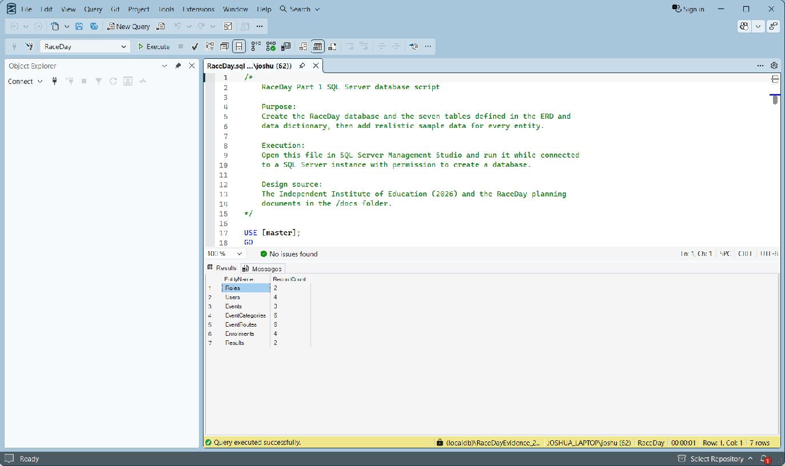
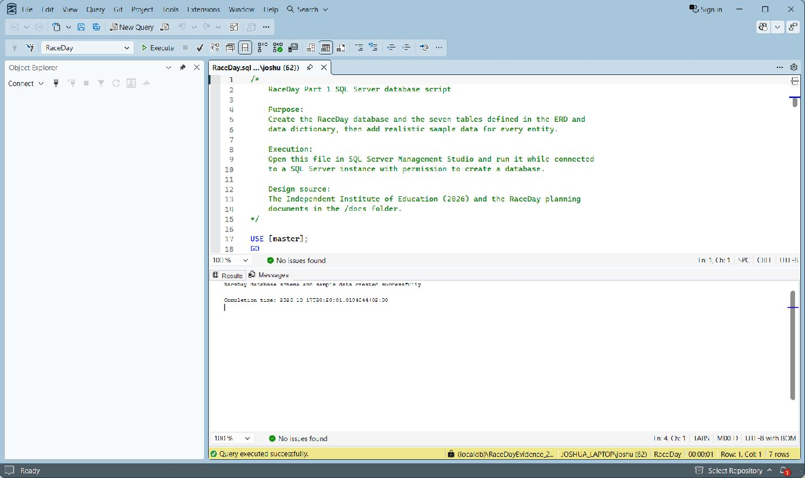

# RaceDay Part 1 Database Corrections

## 1. Changes

The ERD and SQL were checked against the lecturer's feedback on 17 October 2026 (The Independent Institute of Education, 2026).

- The draw.io, SVG and PNG now show the same PascalCase names used in the SQL and data dictionary.
- All 71 columns show their datatypes and NULL rules. Primary keys, foreign keys, composite unique keys and the filtered bib-number index are labelled.
- The nine relationships show UML multiplicities. The Category and Event composite key prevents an Enrolment from using a Category from another Event.
- Completed Results now require a non-null, positive finish time. Other outcomes require NULL. SQL Server CHECK constraints can accept NULL comparisons as UNKNOWN, so the explicit `IS NOT NULL` check is needed (Microsoft, 2026a).
- The script checks that RaceDay is the active database and rejects existing RaceDay tables before creating anything. The guards and schema work stay in one batch so execution cannot continue into a later creation batch after a guard error (Microsoft, 2026b; 2026c).
- Success output is inside the TRY block after the transaction commits. A schema or seed error rolls back the transaction and is rethrown (Microsoft, 2026d).

The tables, columns, seed records and existing foreign-key delete rules have been kept.

## 2. Database checks

The corrected script was run against an empty RaceDay database on a separate SQL Server 2025 LocalDB instance. The empty database used separate data files so the original Part 1 database was not changed. The 21 database checks used `sqlcmd`.

The full script was then run in SSMS on another empty RaceDay database on 17 October 2026. It returned all seven expected record counts and the success message. This used the isolated `(localdb)\RaceDayEvidence_20261017` instance. The original Part 1 SSMS screenshot has been kept separately (Microsoft, 2026e).

| Check | Result |
|---|---|
| Create all seven tables and seed them | Passed |
| Compare all 71 live column names, datatypes, identity settings and NULL rules with the ERD and dictionary | Passed |
| Check all nine foreign keys use NO ACTION on delete and update | Passed |
| Completed finish time: NULL, zero and negative | All rejected |
| Completed finish time: positive | Accepted |
| DidNotFinish, Disqualified and DidNotStart: NULL finish time | All accepted |
| DidNotFinish, Disqualified and DidNotStart: positive finish time | All rejected |
| Rerun with existing tables, without the sqlcmd stop-on-error option | Error 50001; no success message |
| Run the schema batch in the wrong database | Error 50002; no RaceDay tables created there |
| Insert an invalid seed in a separate empty test database | Error returned; all new tables rolled back; no success message |
| Check sample record counts after the rejection checks | Unchanged |

All 21 checks passed. These verify the Part 1 database corrections; API unit tests have not been written yet.

## 3. Sample records

| Table | Records |
|---|---:|
| Roles | 2 |
| Users | 4 |
| Events | 3 |
| EventCategories | 6 |
| EventRoutes | 6 |
| Enrolments | 4 |
| Results | 2 |

The four Users include two Organisers and two Participants. Every Event has Categories, and all seven tables have sample data.

### SSMS record counts



### SSMS success message



## 4. Planning checks

Run the document checks from the repository folder with Python 3 (Python Software Foundation, 2026):

```text
python scripts/validate-planning.py
```

The checks cover all 40 unique endpoint rows, six required columns, the lecturer's 25 method-and-route pairs and their mapping table. They also compare all 71 SQL column definitions with the data dictionary and both editable and SVG diagrams, and check the nine relationship links.

The GitHub Actions workflow runs these checks on every push and on pull requests to main. The existing file, seed-section, writing and commit-count checks remain (GitHub, 2026).

All six workflow command steps passed locally. Nine invalid-document cases were also rejected: missing enrolment DELETE, wrong method, duplicate endpoint, empty description, incorrect mapping, missing additional endpoint, wrong dictionary NULL rule, wrong draw.io datatype and wrong SVG datatype.

The [GitHub run for ae2c47f](https://github.com/ST10441951/prog6212-g2-2026-POE-ST10441951/actions/runs/39057551536) passed. The updated workflow passes locally but has not been pushed yet. Planning checks do not execute the SQL script or test the API.

## References

GitHub (2026) 'Workflow syntax for GitHub Actions', *GitHub Docs*. Available at: https://docs.github.com/en/actions/reference/workflows-and-actions/workflow-syntax (Accessed: 17 October 2026).

Microsoft (2026a) 'Unique constraints and check constraints', *Microsoft Learn*. Available at: https://learn.microsoft.com/en-us/sql/relational-databases/tables/unique-constraints-and-check-constraints (Accessed: 17 October 2026).

Microsoft (2026b) 'THROW (Transact-SQL)', *Microsoft Learn*. Available at: https://learn.microsoft.com/en-us/sql/t-sql/language-elements/throw-transact-sql (Accessed: 17 October 2026).

Microsoft (2026c) 'SQL Server Utilities Statements - GO', *Microsoft Learn*. Available at: https://learn.microsoft.com/en-us/sql/t-sql/language-elements/sql-server-utilities-statements-go (Accessed: 17 October 2026).

Microsoft (2026d) 'TRY...CATCH (Transact-SQL)', *Microsoft Learn*. Available at: https://learn.microsoft.com/en-us/sql/t-sql/language-elements/try-catch-transact-sql (Accessed: 17 October 2026).

Microsoft (2026e) 'Connect and query SQL Server using SQL Server Management Studio', *Microsoft Learn*. Available at: https://learn.microsoft.com/en-us/ssms/quickstarts/ssms-connect-query-sql-server (Accessed: 17 October 2026).

Python Software Foundation (2026) *Python standard library: re, pathlib and xml.etree.ElementTree*. Available at: https://docs.python.org/3/library/ (Accessed: 17 October 2026).

The Independent Institute of Education (2026) *POE Part I General Feedback (HE)*. Lecturer-provided ERD and endpoint feedback.
